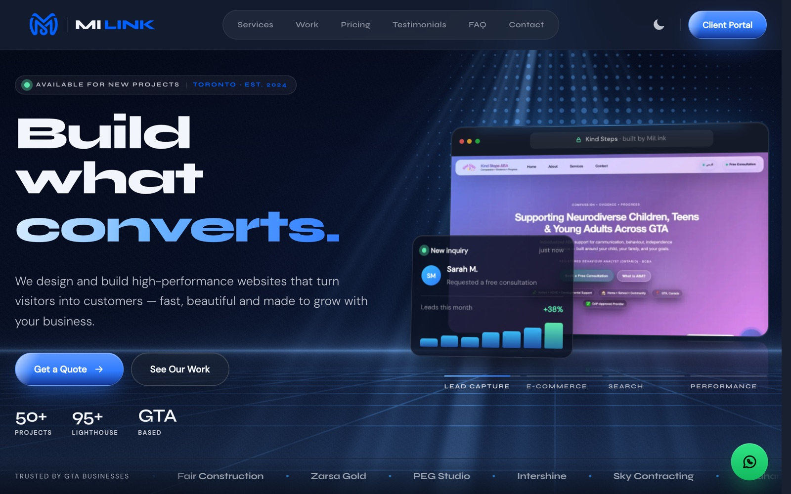

<div align="center">

# 🚀 MiLink — Web Agency Platform

The production site for MiLink, a Toronto web agency: marketing pages, pricing, case studies and a client portal with billing, built on Next.js, Supabase and Stripe.

<a href="https://milink.ca/"></a>
<a href="https://github.com/miladmo68/milink-pro"></a>
<a href="https://miladweb.com"></a>

**🔗 Live:** [milink.ca](https://milink.ca/)

</div>

<p align="center">
  
</p>

## ✨ Features

- Marketing site with services, work, pricing, testimonials and FAQ
- Client portal and admin portal with authentication (Supabase)
- Stripe billing and push notifications
- Animated hero, parallax and count-up effects with Framer Motion
- SEO-ready pages for a local Toronto business

## 🛠️ Tech Stack

         

## 🚀 Getting Started

**Prerequisites:** [Node.js](https://nodejs.org/) 18 or newer

**Install and run**

```bash
git clone https://github.com/miladmo68/milink-pro.git
cd milink-pro
npm install
npm run dev
```

### Environment variables

Create a `.env` file (or `.env.local` for Next.js) with:

```env
ACT=
BUSINESS_ADDRESS=
CHROME_PATH=
CRON_SECRET=
EMAIL_DISPATCH_SECRET=
EVAL=
GRANT=
NEXT_PUBLIC_SITE_URL=
NEXT_PUBLIC_SUPABASE_ANON_KEY=
NEXT_PUBLIC_SUPABASE_URL=
NEXT_PUBLIC_TURNSTILE_SITE_KEY=
NEXT_PUBLIC_VAPID_PUBLIC_KEY=
NOTIFICATION_DIGEST_SECRET=
PRINT=
REPLY_TO_EMAIL=
RM=
SMTP_HOST=
SMTP_PASS=
SMTP_PORT=
SMTP_USER=
STRIPE_SECRET_KEY=
STRIPE_WEBHOOK_SECRET=
SUPABASE_SERVICE_ROLE_KEY=
TO_EMAIL=
TURNSTILE_SECRET_KEY=
URL=
VAPID_PRIVATE_KEY=
VAPID_SUBJECT=
```

## 📁 Project Structure

```
milink-pro/
├── docs/
├── public/
├── scripts/
├── src/
├── supabase/
├── CLAUDE.md
├── desktop.ini
├── MILINK_CODEX_AUTOMATION_V3.md
├── next.config.js
├── package.json
├── PORTAL_INTAKE_REQUIREMENTS.md
├── postcss.config.cjs
├── PROJECT_CONTEXT.md
└── SUPABASE_SETUP.md
```

## 👤 Author

**Milad Mohammadi** — Frontend-Focused Full-Stack Developer, Toronto 🇨🇦

[](https://miladweb.com)
[](https://www.linkedin.com/in/miladmo68/)
[](https://github.com/miladmo68)

<p align="center"><sub>If you like this project, consider giving it a ⭐</sub></p>
